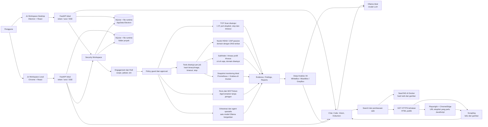
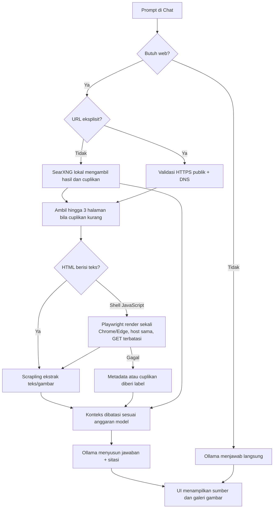

# Arsitektur Jo Workspace 1.14.0

Diagram ini menunjukkan komponen yang benar-benar dipakai aplikasi pada laptop Windows. Electron membundel UI dan backend; mode lokal berbasis sumber memakai Chrome dan backend Python dari folder proyek. Keduanya menyimpan data di lokasi berbeda.

## Alur chat dengan URL

Perenderan JavaScript hanya dicoba untuk URL HTTPS eksplisit dengan HTML awal berupa shell aplikasi. Browser memakai konteks sementara tanpa login, cookie lama, download, POST, redirect, atau akses subresource ke host lain. Proses ini tidak memecahkan CAPTCHA atau challenge Cloudflare. Jika gagal, jawaban tetap membedakan metadata dari isi halaman yang benar-benar dibaca. Pencarian web dan gambar mengirim kueri ke SearXNG, yang meneruskannya ke mesin pencari; pembacaan URL menghubungi situs tujuan. Inferensi LLM tetap melalui Ollama lokal.

## Batas Security Workspace

Engagement dan RoE disimpan per Project. Sebelum Runs yang diizinkan, backend memeriksa versi RoE, scope, pengecualian, waktu, tindakan, port, anggaran, dan persetujuan manusia. URL check production hanya melakukan satu HEAD yang disetujui. Tab Tools & monitoring menjalankan profil terbatas Nuclei HEAD, ZAP passive dari HAR tanpa jaringan, Subfinder/Amass crt.sh-only, dan pembacaan kesehatan Prometheus/Grafana lokal. Binary/image terikat rencana; perubahan scope atau RoE diperiksa kembali selama run. Domain recon dikirim ke crt.sh hanya setelah persetujuan pengungkapan. Penemuan subdomain tidak memperluas scope otomatis.

MCP dan agent spesialis bekerja pada fixture lab sintetis; seluruh hasil harus direview sebelum menjadi finding atau laporan. Endpoint pentest menerima ID job yang disetujui, sedangkan target bebas legacy tetap ditolak (`HTTP 423`). Evidence adapter tersimpan dan dapat dibaca Deep Analisis dengan model Ollama serta ditampilkan dalam Chat Project. Pencarian dan pembacaan halaman di Chat adalah alur terpisah dari Runs keamanan. Lihat [profil dan batas integrasi](TOOL_INTEGRATIONS.md).

## Penyimpanan dan operasi

- Electron terpasang: `%APPDATA%\Agent OS` untuk data runtime dan workspace; executable berada di `%LOCALAPPDATA%\Programs\Jo Workspace`.
- Mode lokal berbasis sumber: `data/runtime` di folder proyek dan shortcut Chrome; riwayat UI mengikuti profil browser yang dipakai.
- `engagements.sqlite3` menyimpan RoE, policy, job, evidence, dan checkpoint. `agent.sqlite3` menyimpan lampiran dan proposal. Usage dan preferensi disimpan di runtime masing-masing.
- SearXNG berjalan di Docker Desktop pada `127.0.0.1:8080`. Chrome atau Edge diperlukan untuk render JavaScript; Playwright memakai browser yang sudah terpasang.
- Monitoring gratis memakai Prometheus `127.0.0.1:9090` dan Grafana `127.0.0.1:3000`, melalui gateway Docker yang hanya dipublikasikan ke loopback. Data ada pada named volume Docker. Dashboard mengukur kesehatan layanan lokal; belum menjadi deteksi login gagal, abuse API, atau DDoS. Lihat [panduan monitoring](deploy/monitoring/README.md).
